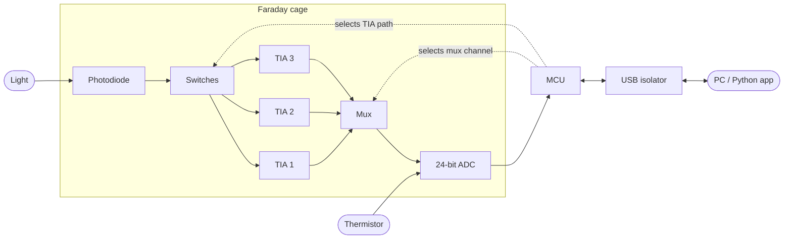

# Optical Power Meter

A high-precision, battery-powered optical power meter built to be robust against noise, temperature drift, and EMI. It measures the intensity of monochromatic light across **80 dB of dynamic range**, using an auto-ranging transimpedance front end, a 24-bit delta-sigma ADC, and a shielded, carefully partitioned PCB.

**Tools:** Altium Designer · LTspice · C (firmware) · Python (host interface)

**Timeline:** February 2026 – March 2026

<!-- Add a hero photo or PCB render here:

-->

---

## Highlights

- **Wide dynamic range (80 dB)** from three switchable transimpedance amplifier (TIA) paths plus ADC programmable gain.
- **Low-noise analog design.** Simulated noise floors of 354 nV, 533 nV, and 1.33 µV RMS across the three paths, equivalent to up to 23.7 stable bits.
- **Simulated with real-world non-idealities** in LTspice: mux leakage, on-resistance and capacitance, bus capacitance, and photodiode junction capacitance.
- **EMI-aware by design.** Faraday cage around the analog chain, guard rings, split grounds, galvanically isolated USB, and firmware that sequences measurement and USB traffic to avoid injecting noise.
- **Auto-ranging firmware in C** that switches op amp feedback paths and ADC gain to maximize range and sensitivity without range "chatter."
- **Temperature and dark-current compensation** using a thermistor bonded to the photodiode and an automatic dark-current zeroing step at power-on.
- **Python interface** for automatic calibration and optical measurement.

## System Overview



The design is split into four subsystems:

### 1. Sensor subsystem
Converts incident light into a voltage the MCU can read.

- **Photodiode:** large active area (or multiple diodes with averaging) to avoid beam clipping. Produces a current roughly linear in light intensity, plus a small dark current.
- **Input switches:** route photodiode current into the selected TIA and tie unused paths to ground to prevent output drift. Chosen for low on-resistance and low leakage.
- **Three TIAs (`Vout = Iin · Rf`):** each has its own feedback resistor and compensation capacitor. Using separate TIAs, rather than switching resistors inside one, keeps mux and switch parasitics out of the feedback network. Feedback capacitances were tuned in transient simulation to avoid both over- and under-damping.
- **Mux:** consolidates the three TIA outputs into the ADC. Low on-resistance and leakage.
- **ADC:** 24-bit delta-sigma ADC (ADS1220) with programmable gain amplifier. Its on-chip digital filtering also rejects high-frequency noise.

### 2. Thermal subsystem
A high-resistance thermistor is thermally bonded to the photodiode casing with thermal epoxy (thermally conductive, electrically insulating), so it tracks the diode temperature rather than the air temperature. It is powered by the ADC's IDAC and read on `AIN3`. Firmware uses a lookup table to correct the photodiode response for temperature.

Noise-conscious layout choices: twisted lead wires, a guard ring between photodiode and thermistor pads, thin 6 mil traces (to limit heat conduction), traces kept non-parallel to photodiode traces, and a small low-pass capacitor across the thermistor leads.

### 3. Power subsystem
- Rechargeable battery, charged over USB by an **MCP73831** charger IC.
- Separate **analog and digital LDOs** so the analog rails stay clean.
- A **DC-DC isolator** for USB power and a **USB isolator (ISO7721)** for USB data, keeping computer noise out of the system.
- **Ferrite beads** on the ADC and op amp supply pins, decoupling capacitors at every IC, and a **500 mA fuse** at the battery terminal to protect against Faraday cage shorts.
- Two operating modes, selected with a switch:
  - **Calibration / Charging:** no measurements are taken. USB charges the battery and carries calibration data to the MCU.
  - **Measure:** charging is off (to avoid EMI), and measurements are streamed to the PC.

### 4. I/O subsystem
USB connector, **USBLC6-2** TVS diode array for ESD protection, UART-to-USB bridge, and isolator. The MCU is programmed over an SWD header. The user supplies the wavelength (or a preset for common sources such as white light or specific lamps) from the PC application, and measurements are returned to the same program.

---

## Simulation (LTspice)

The analog front end was modeled with realistic parasitics (mux leakage, on-resistance, and capacitance; trace capacitance to the ADC; photodiode junction capacitance) and used to tune feedback capacitors and predict the noise floor before layout.

| Path | Integrated RMS noise | Notes |
| --- | --- | --- |
| 1 | 354.42 nV | About 23.7 stable bits. Well above typical commercial optical equipment (roughly 18–22 ENOB). Settling time about 400 ns. |
| 2 | 533 nV | Re-run with a 100 Hz stop frequency. The delta-sigma ADC already filters out high-frequency noise above this. |
| 3 | 1.3324 µV | About 21.85 ENOB. |

1/f noise dominates at low frequencies and the thermal white-noise floor dominates at high frequencies, as expected for op amp TIAs.

<!-- Add noise plots:

-->

---

## Firmware (C)

### Auto-ranging
1. Start on the lowest feedback resistance and step up to higher-gain TIA paths until a reading is obtained.
2. If the ADC reading is below **10%** of full scale, increase PGA gain.
3. If it is above roughly **90%** of full scale (clipping risk), decrease PGA gain.
4. If at PGA gain 1 the signal is still too high, switch the mux to a lower-resistance TIA path (e.g. 1 MΩ → 100 kΩ).
5. **Hysteresis:** the ADC's noise floor (about 16 bits deep on the 1 MΩ path at gain 128) means the bottom 8 bits are ignored when deciding to change range, so the meter does not chatter between ranges.

### Compensation and calibration
- **Thermal compensation:** read the thermistor and apply a lookup-table correction to photodiode current.
- **Initialization (dark current):** at power-on, measure with the sensor covered and subtract the dark-current offset.
- **Factory calibration:** done once after the PCB is assembled and cleaned, against a known voltage source or calibrated light source. A linear correction removes fixed errors (resistor tolerances, soldering stress, gain error, ADC reference tolerance) and is stored in non-volatile memory.
- **User input:** wavelength (or a source preset) is applied to convert photocurrent to optical power.

### Noise-aware scheduling
Sampling is timed to avoid EMI from USB activity and power traces. Measurement and data upload never overlap, and the firmware waits for transfers to finish before sampling.

---

## Python Interface

A host program provides automatic calibration and optical measurement over USB: set the wavelength, run calibration, and log or display intensity readings.

<!-- Add usage instructions once the tool is in the repo:
```bash
pip install -r requirements.txt
python opm.py --port COM3 --wavelength 633
```
-->

---

## Repository Structure

```
optical-power-meter/
├── Block Diagram/   # System block diagram
├── Hardware/        # Altium schematics, PCB layout, and BOM
├── Simulation/      # LTspice models and noise/transient analysis
├── LICENSE
└── README.md
```

## Key Components

| Function | Part |
| --- | --- |
| ADC | ADS1220 (24-bit delta-sigma, with PGA and IDAC) |
| Op amps (TIAs) | OPA392 |
| Battery charger | MCP73831 |
| USB data isolator | ISO7721 |
| USB ESD protection | USBLC6-2 |

## License

Released under the [MIT License](LICENSE).
